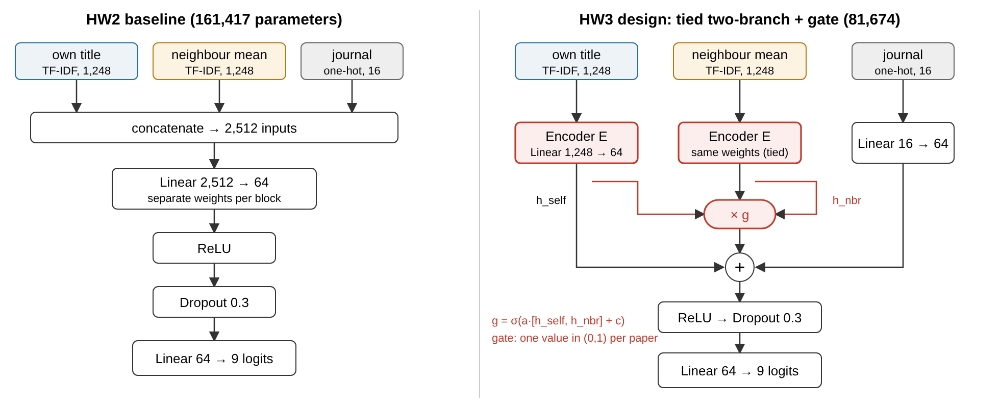
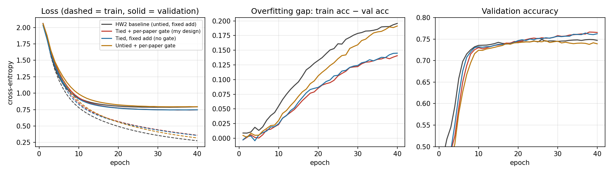
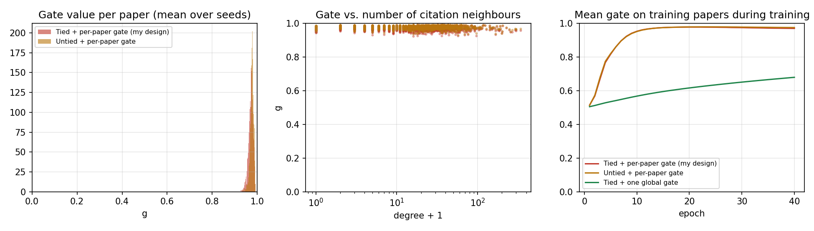

# APS Citation Explorer

DS7400 Deep Learning – Homework 1 (viewer), **Homework 2 (the app now learns and predicts)** and
**Homework 3 (a design experiment on the HW2 network – [jump to the HW3 section](#hw3-break-the-network--a-weight-tied-two-branch-encoder-with-a-learned-neighbour-gate))**.
The application supports data exploration, persistent hide/restore annotation, and a neural network that predicts each paper's
research field (node classification) from within the web UI.

## What it is

An interactive map of physics papers. Each **paper is a node**; **citations are edges**. The viewer works on a
2,000-paper sample of the [APS (American Physical Society) dataset](https://journals.aps.org/datasets) – papers published in
Physical Review journals between 2016 and 2022 – with the 20,381 citations between them.

## Type of data

**Graph / network data** (a citation network). Per paper: title, authors, affiliations, journal, date, DOI, article type,
PhySH topic classification (disciplines + concepts), and citation links.

Citation edges point from the citing paper to the cited paper. The displayed links connect only papers in the sample;
the citation counts used for dot sizes and filtering count incoming citations from the broader 2016–2022 APS paper set.
They are not worldwide citation totals. The sample spans 19 disciplines and favors well-connected papers, so it is intended
for exploration rather than as an unbiased representation of all APS research.

## Running the application

Requirements: Node.js 20+, npm, and Python 3.10+. The sample data (`frontend/public/data/graph.json`) is committed.
Run the backend and the frontend in **two terminals**, both from the repo root.

**Terminal 1 – backend (FastAPI + SQLite):**

```bash
python3 -m venv .venv
source .venv/bin/activate                   # Windows PowerShell: .venv\Scripts\Activate.ps1
python -m pip install -r backend/requirements.txt
python -m uvicorn backend.app.main:app --port 8000  # creates backend/data/aps.db on first start
```

**Terminal 2 – frontend:**

```bash
cd frontend
npm install
npm run dev        # then open the printed URL, normally http://localhost:5173
```

The header shows **Backend connected** once the two are talking. Without the backend the viewer still works, but hiding papers is disabled.
Instead of `pip`/`uvicorn`, the backend can also run in Docker: `docker compose up --build` (not tested on the author's machine, where Docker isn't installed).

## Features

- **Map view** – all papers as dots on a 2-D map (WebGL, via deck.gl). Drag to pan, scroll to zoom, *Reset view* to refit.
  Nearby dots have similar PhySH topics and citation neighbours; color = discipline; size = number of citations received.
- **Hover** a dot for a tooltip (title, authors, journal/year, citation count, discipline).
- **Click** a dot to select it: its references (black) and citing papers (red) are drawn, unrelated papers fade out, and the
  detail panel shows authors, affiliations, DOI link, journal details, PhySH topics, and clickable lists of
  *References* and *Cited by* to hop through the citation network.
- **Search** by title words, author name or DOI; picking a result flies to that paper.
- **Filters** – journal, year range, minimum citations, and per-discipline toggles (the legend doubles as the filter).
  Optionally draw all 20K citation links.
- **Interactive annotation: hide papers you don't want to see** – select a paper and click **Hide this paper** in the detail panel.
  It disappears from the map (with its citation lines), from search, and from the References / Cited by lists. A toast offers **Undo**,
  and everything you've hidden is listed under **Hidden papers** in the sidebar with **Restore** / **Restore all** buttons.
  It is a user-curated mark on individual nodes, stored in the database, so it persists across reloads and restarts.
  Hiding never deletes a paper's metadata or citation data; restoring removes only its hidden status.
- **Backend / database** – a FastAPI + SQLite service stores which papers are hidden (plus the sample's paper metadata).

## Major libraries and frameworks

React 19, Vite 6, [deck.gl](https://deck.gl) 9 (WebGL rendering). Backend: FastAPI, SQLite (Docker optional). Neural network: PyTorch, scikit-learn. Data pipeline: Python, pandas, SciPy, scikit-learn, UMAP.

## Project layout

```
frontend/src/App.jsx                 state: selection, filters, search
frontend/src/components/GraphMap.jsx the deck.gl map
frontend/src/components/Sidebar.jsx  search, filters, legend
frontend/src/components/DetailPanel.jsx  selected-paper details
frontend/src/data.js                 loads graph.json, builds cites / cited-by lookups
frontend/src/api.js                  calls to the backend API
backend/app/main.py                  FastAPI app + SQLite schema + API routes
backend/app/ml.py                    loads the model, predicts, trains in a background thread
backend/model/                       trained weights (model.pt), metrics.json, loss_curve.png
training/data.py, model.py, train.py features + split, the MLP, the training loop
training/hw3_model.py, hw3_experiments.py, hw3_analyze.py, hw3_config.json   HW3 design, experiments, analysis
results/hw3/                         HW3 results (JSON, summary table, figures)
docs/HW3_report.pdf                  HW3 experiment summary
backend/Dockerfile, docker-compose.yml   optional Docker setup for the backend
frontend/public/data/graph.json      the sample dataset (generated)
pipeline/build_data.py               builds graph.json from the raw APS files
01_explore_aps_dataset.ipynb          initial exploration of raw citations and metadata
```

The frontend loads `graph.json` directly and builds reference/cited-by lookups in the browser. Vite forwards `/api`
requests to FastAPI on port 8000; the backend seeds paper metadata into SQLite and saves hide/restore choices.
The exploration notebook uses an original cluster-specific `BASE_DIR`; update that path to your local APS folder before running it.

## Regenerating the sample (optional)

The full raw dataset (~720K papers, 9.8M citations) is **not** in this repo. To rebuild the sample from it:

```bash
pip install -r pipeline/requirements.txt
python pipeline/build_data.py --aps-dir /path/to/APS --n 2000
```

`--aps-dir` must contain `aps-dataset-metadata-2022/` and `aps-dataset-citations-2022.csv`. The script keeps 2016–2022 papers,
draws a sample stratified by discipline (seed papers, then the papers most linked to them, so the sample has visible citation
structure), keeps the citations among sampled papers, and lays the papers out with UMAP over PhySH topics + citation structure.

## Annotation and backend

- Interactive annotation: **implemented as a hidden/visible status on individual graph nodes**, with hide, undo, and restore controls.
  Free-text notes, custom tags, and an “Important” label are not implemented in the current version.
- Backend / database: **implemented** (FastAPI + SQLite).

### Backend API

| Method & path | Purpose |
|---|---|
| `GET /api/stats` | number of papers and of hidden papers |
| `GET /api/hidden` | DOIs and timestamps of all hidden papers |
| `PUT /api/hidden/{doi}` | hide a paper (safe to repeat) |
| `DELETE /api/hidden/{doi}` | restore one paper |
| `DELETE /api/hidden` | restore all papers |

SQLite tables: `papers` (metadata for the 2,000 sampled papers, seeded from `graph.json` at startup) and `hidden_papers`
(DOI + time hidden). Hiding inserts a row into `hidden_papers` and leaves the `papers` row and source graph unchanged.
Restoring deletes only the corresponding `hidden_papers` row. Hidden status is keyed by DOI rather than sample index,
so it can be retained for the same paper when the sample is rebuilt. These choices are shared by clients using the same backend;
there are no separate user accounts. The database file
`backend/data/aps.db` is git-ignored. Interactive API docs are at http://localhost:8000/docs while the backend runs.

### Demonstrating persistence

With both services running, select a paper, click **Hide this paper**, and reload the page. The paper remains in the
**Hidden papers** list. Click **Restore** to bring it back, or **Restore all** to clear all hidden statuses.

For the local Python backend, the following read-only queries can demonstrate the stored status and preserved metadata
from the repository root (requires the SQLite command-line tool):

```bash
sqlite3 backend/data/aps.db "SELECT doi, hidden_at FROM hidden_papers LIMIT 5;"
sqlite3 backend/data/aps.db "SELECT p.doi, p.title FROM papers p JOIN hidden_papers h ON p.doi = h.doi LIMIT 5;"
```

The Docker setup stores its database in the `aps-data` volume instead of this local path.

## HW2: neural-network field prediction

**Task – node classification.** Predict each paper's PhySH **discipline** (top-level research field). The 8 largest disciplines are
their own class; the 11 small ones are merged into "Other" → 9 classes. Labels are the primary `discipline` of each paper.

**Inputs (no label leakage).** Title TF-IDF (1,500 terms, vocabulary fit on training papers only) + journal one-hot +
the mean title TF-IDF of the paper's citation neighbours (one round of message passing over the undirected citation graph).
Discipline, PhySH concepts and the UMAP coordinates are *not* used. The journal is a strong but legitimate metadata signal.

**Model.** A small MLP (`training/model.py`): 2,512 inputs → 64 hidden units → ReLU → dropout 0.3 → 9 logits. Cross-entropy loss, Adam,
mini-batches of 64, weight decay 1e-3, 40 epochs; the weights from the epoch with the lowest validation loss are kept.
`training/train.py` makes every step explicit: forward pass → loss → `loss.backward()` (backpropagation) → `opt.step()` (gradient update).
Stratified split (seed 0): 1,400 train / 300 validation / 300 test papers.

**Results (test set, 300 held-out papers)** – `backend/model/metrics.json`, loss curve `backend/model/loss_curve.png`:

| Model | Test error | Test accuracy | Macro-F1 |
|---|---|---|---|
| Majority class | 62.3% | 37.7% | 0.061 |
| Shallow benchmark: logistic regression (same features, no hidden layer) | 26.7% | 73.3% | 0.581 |
| **MLP (this work)** | **23.0%** | **77.0%** | **0.610** |

The MLP beats the shallow benchmark, but only by ~4 points on 300 test papers, so the gap is small and noisy. Training accuracy (~93%) is much
higher than validation (~75%): with 1,400 papers and ~160K parameters the network overfits, which dropout / weight decay / best-epoch selection only partly
control. Small classes ("Other", General Physics) are the weak spot (macro-F1 ≪ accuracy). Hyper-parameter sweeps (dropout, weight decay, width, learning rate) all landed
around 75–77%, so the data size, not tuning, is the limit.

### Using it in the app

1. **Predict field** – select a paper, click **Predict field** in the detail panel. The request goes React → `GET /api/predict/{doi}` → FastAPI → PyTorch model →
   the panel shows the predicted field, confidence, top-5 probabilities, whether it matches the recorded field, and whether the paper was in train/val/test.
2. **Color by "prediction correct?"** (map, top-left) – green = right, red = wrong, training papers faded.
3. **Neural network** button (header) – opens the **training monitor** (live train/val/test loss and accuracy curves, metrics table, comparison with the baselines)
   and **interactive training**: change learning rate, epochs, hidden units, hidden layers, dropout, activation and optimizer, press **Train**, and watch the curves
   update epoch by epoch (polls `GET /api/train/status`). The newly trained model becomes the active one for predictions in that session; **Reset to pre-trained** restores the shipped weights.
   (Retrained models are never written to `model.pt`.)

### Retrain from the command line

```bash
python -m pip install -r backend/requirements.txt
python training/train.py        # writes backend/model/model.pt, metrics.json, loss_curve.png
```

### Extra API endpoints

| Method & path | Purpose |
|---|---|
| `GET /api/model` | active model's hyper-parameters, metrics, baselines, loss history |
| `GET /api/predict/{doi}` | predicted field + probabilities for one paper |
| `GET /api/predictions` | predicted/true class and split for every paper |
| `POST /api/train` | start training in the background with the given hyper-parameters |
| `GET /api/train/status` · `POST /api/train/stop` | live progress · stop early |
| `POST /api/model/reset` | restore the shipped weights |

### AI-use disclosure

Claude Code (Anthropic) wrote most of the first implementation of the training code, the backend endpoints and the React components under the author's direction;
the PyTorch MLP follows the standard pattern (nn.Sequential of Linear/activation/dropout layers + Adam + cross-entropy). The author is responsible for understanding and
being able to explain the model, the features and the training loop. The logistic-regression baselines use scikit-learn.

### Other optional extensions (not yet implemented)

Related-paper recommendations (learned embeddings) and citation link prediction. A graph neural network would be the natural next model for field prediction.

## HW3: break the network – a weight-tied two-branch encoder with a learned neighbour gate

Full write-up: [`docs/HW3_report.pdf`](docs/HW3_report.pdf). Code: `training/hw3_model.py`, `training/hw3_experiments.py`,
`training/hw3_analyze.py`, settings in `training/hw3_config.json`, outputs in `results/hw3/`.

**Task and dataset (unchanged from HW2).** Node classification on the 2,000-paper APS citation sample: predict each paper's PhySH
discipline (9 classes) from its title TF-IDF (1,248 terms), the mean title TF-IDF of its citation neighbours (1,248) and its journal (16).
Same stratified split (1,400 / 300 / 300, seed 0), cross-entropy loss, Adam (lr 1e-3, weight decay 1e-3), batch 64, 40 epochs,
weights from the best-validation-loss epoch. Metrics: test accuracy and macro-F1.

**Baseline (HW2).** One flat vector → `Linear(2512, 64)` → ReLU → Dropout 0.3 → `Linear(64, 9)`; 161,417 parameters.



**Problem.** The HW2 model overfits (93% train vs 75% validation accuracy) and 99.6% of its parameters sit in the first layer. That layer learns
two unrelated weight matrices for "own title" and "neighbour titles" even though both are TF-IDF vectors over the *same* vocabulary,
and it has no way to decide, per paper, how much to trust the neighbours.

**Proposed modification.** (1) *Weight tying:* both text inputs go through the same encoder `E`, which halves the parameter count.
(2) *Learned gate:* the neighbour branch is added to the own-title branch like a residual correction, scaled by a per-paper gate
`g = sigmoid(a·[h_self, h_nbr] + c)`: `h = ReLU(E(x_self) + g · E(x_nbr) + W_j x_journal)`.

**Hypothesis (written before running).** Tying should reduce overfitting and raise test accuracy, because the word "superconductivity"
means the same thing in a paper's own title and in its neighbours' titles. The gate should learn to close for papers whose neighbours are
uninformative (few or mixed-field neighbours). It might fail if the two inputs actually need different weights (a mean over many titles
is not distributed like one title), or if the gate saturates and becomes a constant.

### Running the experiments

```bash
python -m pip install -r backend/requirements.txt
python training/hw3_experiments.py                                   # 6 variants x 10 seeds, ~1.5 min on CPU
python training/hw3_experiments.py --epochs 80 --only baseline,tied_gated,tied_add --tag ep80   # training-budget check
python training/hw3_analyze.py                                       # writes results/hw3/summary.md, curves.png, gates.png
```

### Main results (40 epochs, mean ± std over 10 seeds; accuracy in %)

| Variant | Params | Train acc | Val acc | Test acc | Test macro-F1 | Train−val gap | Test diff vs baseline (paired, ± s.e.) |
|---|---|---|---|---|---|---|---|
| HW2 baseline (untied, fixed add) | 161,417 | 92.7 | 74.7 ± 0.6 | 77.2 ± 0.3 | 0.613 | 18.0 | – |
| **Tied + per-paper gate (my design)** | 81,674 | 89.9 | 76.4 ± 0.5 | 76.3 ± 0.7 | 0.610 | 13.5 | −0.9 ± 0.3 |
| Ablation: tied, fixed add (no gate) | 81,545 | 89.6 | 76.2 ± 0.5 | 76.3 ± 0.7 | 0.606 | 13.4 | −0.9 ± 0.2 |
| Ablation: untied + per-paper gate | 161,610 | 92.0 | 74.2 ± 0.6 | 76.6 ± 0.6 | 0.606 | 17.7 | −0.6 ± 0.2 |
| Ablation: tied + one global gate | 81,546 | 90.5 | 75.1 ± 0.8 | 75.4 ± 0.9 | 0.594 | 15.4 | −1.8 ± 0.3 |
| Ablation: tied, neighbour branch removed | 81,545 | 90.4 | 73.7 ± 0.5 | 72.1 ± 0.6 | 0.556 | 16.7 | −5.1 ± 0.2 |




### What happened and what I learned

- **Weight tying did what I hoped to the overfitting gap, but not to test accuracy.** With half the parameters the train−validation gap fell from
  18.0 to 13.5 points and validation accuracy rose by 1.7 points, but test accuracy fell by 0.9 points (about 3 of 300 papers). Validation and
  test disagree on the sign, so the honest reading is "same accuracy with half the parameters", not an improvement.
- **The gate was a failure, in the way I listed as a risk.** It opened to g ≈ 0.97 for every paper within about 10 epochs (std across papers 0.011),
  with no relation to the number of neighbours (correlation −0.02). The gated model is therefore the fixed-addition model: identical test accuracy (76.3).
- **Why the gate saturated.** Neighbours are the most valuable input (removing them costs 5 points), so the loss always pushes the gate open,
  and a sigmoid gate can only *shrink* the branch. It had nothing useful to do.
- **The global-gate ablation was worst for an optimisation reason, not a modelling one.** Its single parameter starts at g = 0.5 and Adam moves it
  at most about lr = 0.001 per step, so after 880 steps it had only reached 0.68 and the model was still under-using neighbours.
- **Training longer did not change the picture** (80 epochs: baseline 77.2, tied + gate 76.4, tied 76.5), so the fixed budget is not the explanation.
- **Cost.** Half the parameters, but training was slightly slower (1.35 s vs 1.07 s per run) because of two encoder passes and the gate.
- **Next experiment.** Repeat over several train/val/test splits, since split noise is larger than the effects here; give the gate the neighbour count
  as an input and let it exceed 1; and test the hint that papers with more than 30 neighbours do better *without* the neighbour branch (80.9% vs 78.4%, n = 58).

### AI-use disclosure (HW3)

Claude (Anthropic) listed candidate limitations and design ideas, implemented the model and experiment scripts, generated the plots and helped
draft this write-up. The author chose the design (weight-tied branches with a learned gate), and is responsible for the hypothesis and conclusions.

## Notes

The APS dataset comes from the APS Data Sets for Research programme; the sample here is a small subset for coursework.
